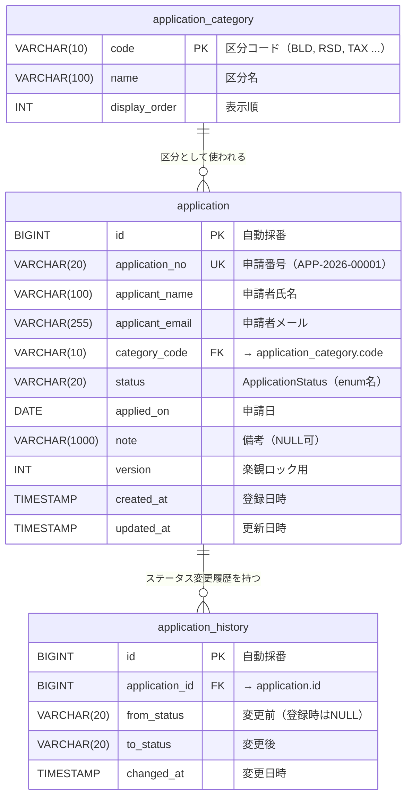
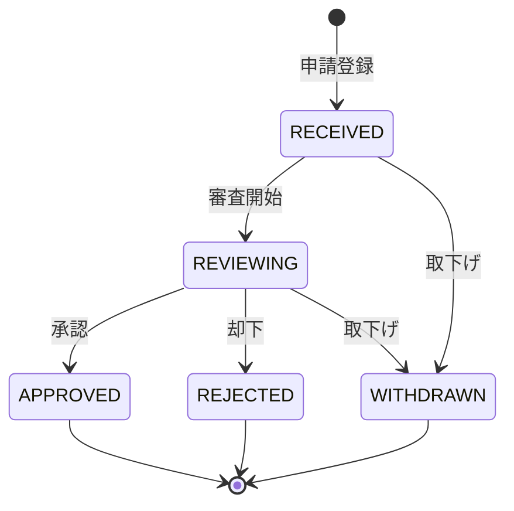

# ER図（申請管理システム）

`backend/src/main/resources/schema.sql` から起こした ER 図です。

## 補足

| 項目 | 内容 |
|---|---|
| カーディナリティ | 区分 1 : N 申請、申請 1 : N 履歴 |
| `status` | テーブルではなく Java の enum `ApplicationStatus` で管理（RECEIVED / REVIEWING / APPROVED / REJECTED / WITHDRAWN） |
| インデックス | `application` の `status`、`applied_on`、`applicant_name` |
| 一意制約 | `application.application_no` |

## ステータス遷移（ApplicationStatus.allowedNextStatuses）

